<div align="center">

<picture>
  <source media="(prefers-color-scheme: dark)" srcset="./assets/banner-dark.svg">
  <source media="(prefers-color-scheme: light)" srcset="./assets/banner-light.svg">
  
</picture>
<picture>
  <source media="(prefers-color-scheme: dark)" srcset="./assets/statusbar-dark.svg">
  <source media="(prefers-color-scheme: light)" srcset="./assets/statusbar-light.svg">
  
</picture>

</div>

<br>

<div align="center">

<a href="https://skylor-tang.github.io"></a>
<a href="mailto:tang1996mei@gmail.com"></a>
<a href="https://github.com/Skylor-Tang?tab=repositories"></a>


</div>

<br>

<kbd>~/about.md</kbd>

## 关于

写后端，也写自己的工具链。

白天在 Python 与 Go 之间来回——接口、协议、限流、数据一致性；晚上把重复的事做成工具，比如一个进目录就自动激活虚拟环境的 zsh 插件。最近两三年，时间主要花在 **AI Agent 的工程化**上：上下文怎么组织、工具怎么暴露、能力怎么被稳定地复用。

判断标准一直没变：**一件事如果没法用一句话说清，那多半还没想清楚。**

<br>

<div align="center">

<picture>
  <source media="(prefers-color-scheme: dark)" srcset="./assets/flow-dark.svg">
  <source media="(prefers-color-scheme: light)" srcset="./assets/flow-light.svg">
  
</picture>

<sub>一个需求到我手上的固定路径 —— <code>能跑 &gt; 能完美</code></sub>

</div>

<br>

`现在` 做 [pi-depot](https://github.com/Skylor-Tang/pi-depot)，把 Agent 的全部能力做成看得见的面板 &nbsp;·&nbsp; `在学` Go 运行时与协议设计 &nbsp;·&nbsp; `在写` 算法与数据结构笔记

<kbd>~/CHANGELOG.md</kbd>

## 履历

<table>
<thead>
<tr>
<th align="left" width="12%">版本</th>
<th align="left" width="18%">时间</th>
<th align="left">说明</th>
</tr>
</thead>
<tbody>
<tr>
<td><code>v4.0</code></td>
<td>2024 — </td>
<td>AI Agent 工具链：Skills 机制、MCP、任务接力协议、本地优先面板</td>
</tr>
<tr>
<td><code>v3.0</code></td>
<td>2021 — 2023</td>
<td>转向 Go 与基础设施：并发、协议、限流，开始做给开发者用的工具</td>
</tr>
<tr>
<td><code>v2.0</code></td>
<td>2018 — 2020</td>
<td>Django 全栈：商城、后台、权限校验，前端也自己写 Vue</td>
</tr>
<tr>
<td><code>v1.0</code></td>
<td>2016</td>
<td><code>print("Hello, World")</code>，第一门语言学的是 Python</td>
</tr>
</tbody>
</table>

<kbd>~/projects/</kbd>

## 作品

<table>
<thead>
<tr>
<th align="left" width="27%">项目</th>
<th align="left">是什么</th>
<th align="left" width="16%">栈</th>
</tr>
</thead>
<tbody>
<tr>
<td><a href="https://github.com/Skylor-Tang/pi-depot"><b>pi-depot</b></a></td>
<td>Pi 编码助手的本地可视化配置仓库：扩展、技能、提示词、MCP 与模型一屏管理。</td>
<td><code>TypeScript</code></td>
</tr>
<tr>
<td><a href="https://github.com/Skylor-Tang/auto-venv"><b>auto-venv</b></a><br></td>
<td>进目录即自动激活 Python 虚拟环境的 zsh 插件，几行 zsh，零学习成本。</td>
<td><code>Shell</code></td>
</tr>
<tr>
<td><a href="https://github.com/Skylor-Tang/zshrc-sync"><b>zshrc-sync</b></a><br></td>
<td>.zshrc 变更自动检测并同步到 Git 仓库，换机不再丢配置。</td>
<td><code>Shell</code></td>
</tr>
<tr>
<td><a href="https://github.com/Skylor-Tang/django-adminutilities"><b>django-adminutilities</b></a></td>
<td>把注册的自定义函数与系统工具，直接暴露成 Django Admin 里的操作。</td>
<td><code>Python</code></td>
</tr>
<tr>
<td><a href="https://github.com/Skylor-Tang/django-auth-ipwhitelist"><b>django-auth-ipwhitelist</b></a></td>
<td>Django 登录 IP 白名单认证后端：很少的代码，很硬的边界。</td>
<td><code>Python</code></td>
</tr>
<tr>
<td><a href="https://github.com/Skylor-Tang/skills-agent-proto"><b>skills-agent-proto</b></a></td>
<td>基于 LangChain 1.0 的 Skills Agent，演示 Skills 三层加载的底层原理。</td>
<td><code>Python</code></td>
</tr>
</tbody>
</table>

<div align="center">
  <a href="https://github.com/Skylor-Tang?tab=repositories"><b>全部 100+ 个仓库 →</b></a>
</div>

<kbd>~/toolbox.sh</kbd>

## 工具箱

<div align="center">


</div>

<table>
<tr>
<td valign="top" width="22%"><b>语言</b></td>
<td>Python · Go · TypeScript · Shell</td>
</tr>
<tr>
<td valign="top"><b>后端</b></td>
<td>Django / DRF · FastAPI · Flask · REST 与协议设计 · 限流与鉴权</td>
</tr>
<tr>
<td valign="top"><b>数据与基础设施</b></td>
<td>PostgreSQL · Redis · SQLite · Docker · Linux · Nginx · CI/CD</td>
</tr>
<tr>
<td valign="top"><b>AI 工程</b></td>
<td>Agent Skills · Tool / MCP 集成 · Prompt 与上下文设计 · 多 Agent 编排</td>
</tr>
</table>

---

<details>
<summary><sub>🥚 &nbsp;README 没有写进去的部分</sub></summary>

<br>

```console
$ git log --oneline --follow ~/career | tail -1
3f2a1c9  v1.0  第一次 print("Hello, World")，跑通就开心了一晚上

$ history | grep -c "rm -rf node_modules"
1247

$ cat ~/philosophy.txt
简单不是功能少，而是没有多余的东西。
```

</details>

<br>

<div align="center">


<br><br>

> 今天的优势，会被明天的趋势替换。<br>所以，持续学习。

<sub>Backend engineer in Shanghai · Python / Go / TypeScript · building tooling for developers &amp; agents.</sub>

<br>

<sub>上面三张图（banner · 状态栏 · 流程图）都是手写 SVG，无第三方图床，跟随你的深色/浅色模式自动切换。</sub>

</div>
