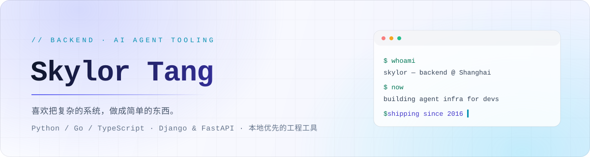

<div align="center">

<picture>
  <source media="(prefers-color-scheme: dark)" srcset="./assets/banner-dark.svg">
  <source media="(prefers-color-scheme: light)" srcset="./assets/banner-light.svg">
  
</picture>
<picture>
  <source media="(prefers-color-scheme: dark)" srcset="./assets/statusbar-dark.svg">
  <source media="(prefers-color-scheme: light)" srcset="./assets/statusbar-light.svg">
  
</picture>

<br>

<a href="https://skylor-tang.github.io"></a>
<a href="mailto:tang1996mei@gmail.com"></a>


</div>

## $ cat ~/skylor.yaml

```yaml
role:     后端工程师 · Shanghai
stack:    [python, go, typescript]
backend:  [django, drf, fastapi, flask]
now:      agent 工具链 —— skills / mcp / 本地优先面板
learning: go runtime · 协议设计
rule:     说不清的事，多半还没想清楚
```

## $ ./how-i-work

<div align="center">
<picture>
  <source media="(prefers-color-scheme: dark)" srcset="./assets/flow-dark.svg">
  <source media="(prefers-color-scheme: light)" srcset="./assets/flow-light.svg">
  
</picture>
</div>

## $ ls ~/projects

<table>
<thead>
<tr>
<th align="left" width="33%">项目</th>
<th align="left">是什么</th>
<th align="left" width="16%">栈</th>
</tr>
</thead>
<tbody>
<tr>
<td width="33%"><a href="https://github.com/Skylor-Tang/pi-depot"><b>pi-depot</b></a></td>
<td>Agent 全部能力的可视化面板</td>
<td width="16%"><code>TypeScript</code></td>
</tr>
<tr>
<td width="33%"><a href="https://github.com/Skylor-Tang/auto-venv"><b>auto-venv</b></a> </td>
<td>进目录自动激活 venv 的 zsh 插件</td>
<td width="16%"><code>Shell</code></td>
</tr>
<tr>
<td width="33%"><a href="https://github.com/Skylor-Tang/zshrc-sync"><b>zshrc-sync</b></a> </td>
<td>.zshrc 变更自动同步到 Git</td>
<td width="16%"><code>Shell</code></td>
</tr>
<tr>
<td width="33%"><a href="https://github.com/Skylor-Tang/django-adminutilities"><b>django-adminutilities</b></a></td>
<td>把自定义函数暴露成 Admin 操作</td>
<td width="16%"><code>Python</code></td>
</tr>
<tr>
<td width="33%"><a href="https://github.com/Skylor-Tang/django-auth-ipwhitelist"><b>django-auth-ipwhitelist</b></a></td>
<td>登录 IP 白名单认证后端</td>
<td width="16%"><code>Python</code></td>
</tr>
<tr>
<td width="33%"><a href="https://github.com/Skylor-Tang/skills-agent-proto"><b>skills-agent-proto</b></a></td>
<td>Skills 三层加载机制的原理演示</td>
<td width="16%"><code>Python</code></td>
</tr>
</tbody>
</table>

## $ tree ~/stack

```text
~/stack
├── lang      python · go · typescript · shell
├── backend   django · drf · fastapi · flask
├── data      postgres · redis · sqlite
├── infra     docker · linux · nginx · ci/cd
└── agent     skills · mcp · tool-use · orchestration
```

## $ git log --oneline ~/career

```text
e7a25d3  v4.0  2024-  agent 工具链 · skills · mcp
c4d9f11  v3.0  2021   go · 协议 · 限流 · 基础设施
8b1e204  v2.0  2018   django 全栈 · 商城 · 后台
3f2a1c9  v1.0  2016   print("Hello, World")
```

---

<div align="center">

> 今天的优势，会被明天的趋势替换。所以，持续学习。

<sub>本页 banner / 状态栏 / 流程图均为手写 SVG（无第三方图床），自动跟随深浅色，页面加载时依次启动。</sub>

</div>
